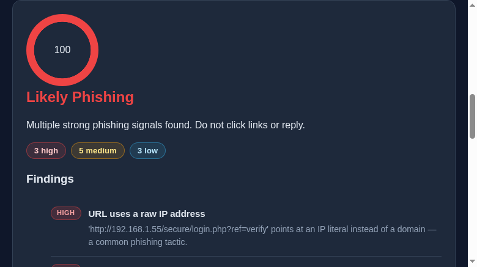

# 🛡️ PhishGuard

[](LICENSE)

A lightweight, explainable **phishing email analyzer**. Paste a suspicious email and get a
0–100 risk score with a plain-English list of exactly *why* it looks phishy.

Built as a classroom / hackathon project to demonstrate how phishing signals can be detected
with transparent heuristics instead of a black-box model.

🌐 **Live demo (no install):** <https://bclarketech.github.io/VW-Hackathon-phishguard/>



## What it detects

| Category | Examples |
|---|---|
| **Sender tricks** | Brand in display name but unrelated sender domain, free-mail senders, lookalike domains (`paypa1-login.com`) |
| **URL tricks** | Raw IP hosts, punycode/IDN domains, deep subdomains, misleading `@`, `http://` links |
| **Link text mismatch** | `<a href="http://evil.com">https://paypal.com</a>` |
| **Language** | Urgency, threats of suspension, credential/SSN requests, fake security alerts, prize/advance-fee bait |
| **Other** | Generic greetings, suspicious attachment types |

Each finding is weighted (high/medium/low), summed into a **0–100 score**, and mapped to a
verdict: `likely_safe` · `suspicious` · `likely_phishing`.

## Quick start (run locally)

```bash
python3 -m venv .venv
source .venv/bin/activate
pip install -r requirements.txt

# Development (debug OFF):
python app.py            # serves on http://127.0.0.1:8000

# Production-style:
gunicorn -w 2 -b 127.0.0.1:8000 app:app
```

Open <http://127.0.0.1:8000> and click **"Load a phishing sample"** to see it in action.

## Run the tests

```bash
python -m unittest discover -s tests -v
```

## How the score works

The score is just points that add up. Here's how:

**1. Every red flag has a severity, and each severity is worth set points.**

| Severity | Points | Examples |
|---|---|---|
| High | 25 | Raw IP link, fake brand domain, link text that lies |
| Medium | 12 | Urgency, account threats, free-mail sender |
| Low | 5 | No https, "Dear Customer" |
| Info | 0 | No sender given (just a note — it doesn't count) |

**2. Points add up.** Each bad link counts separately, so two IP-address links add 50.

**3. The total is capped at 100.** It can't go below 0 or above 100.

**4. The total picks the verdict.**

| Score | Verdict |
|---|---|
| 0–29 | Likely safe |
| 30–59 | Suspicious |
| 60–100 | Likely phishing |

### Worked example (the demo email)

| | Calculation | Points |
|---|---|---|
| 3 high flags | × 25 | = 75 |
| 5 medium flags | × 12 | = 60 |
| 3 low flags | × 5 | = 15 |
| **Raw total** | | **150 → capped at 100** → **Likely phishing** |

All **21 tests** pass. They cover:

| Layer | What's proven |
|---|---|
| **Detection engine** | Brand/display-name mismatch, lookalike sender domains, raw-IP URLs, urgency + credential-harvest language are all flagged; a clean email passes |
| **Scoring rules** | Score is clamped to 0–100, finding counts always match the findings list, reports serialize to JSON |
| **Web API** | `/healthz` responds; `/analyze` handles JSON, form posts, raw `.eml` strings, and uploaded `.eml` files; empty input is rejected with 400 |
| **Safety rails** | Oversized input is rejected (413), and error paths never lose what the user typed |

## Design & security notes

- **No storage.** Pasted emails are analyzed in memory only — nothing is written to disk,
  logged, or transmitted.
- **Debug mode stays off.** `app.py` runs `debug=False`, and the intended production command is
  `gunicorn`. The interactive Werkzeug debugger is a remote-code-execution risk if exposed.
- **Bounded input.** Pastes are capped at 50,000 characters to keep memory use predictable.
- **Deterministic & offline.** No external API calls during analysis; the same input always
  yields the same report.

> ⚠️ PhishGuard is a **teaching tool**, not a production mail gateway. It should complement —
> not replace — real email authentication (SPF/DKIM/DMARC) and gateway filtering.

## Project layout

```
phishguard/
├── app.py              # Flask routes (no debug, no storage)
├── analyzer.py         # Heuristic detection engine
├── docs/               # Browser-only edition (GitHub Pages, zero backend)
│   ├── index.html
│   ├── app.js
│   └── analyzer.js     # JS port of analyzer.py (same engine, same results)
├── templates/
│   └── index.html      # UI
├── static/
│   ├── style.css
│   └── app.js          # Score-ring animation + demo sample
├── tests/
│   ├── test_analyzer.py
│   └── test_app.py
├── media/              # README screenshots
├── LICENSE             # MIT
├── requirements.txt
└── README.md
```

## Future improvements

- Parse real email headers (SPF/DKIM/DMARC results) from raw `.eml` input
- URL reputation lookup (with caching) for live domain checks
- Containerized deployment (Docker + Kubernetes) behind a Cloudflare Tunnel
- Machine-learning classifier trained on a public phishing corpus

## Team

- **Chris Clarke** — detection engine, Flask API, browser edition, deployment
- **[Teammate 2]** — [role]
- **[Teammate 3]** — [role]

## License

[MIT](LICENSE) — free to use, study, and adapt (attribution appreciated).
